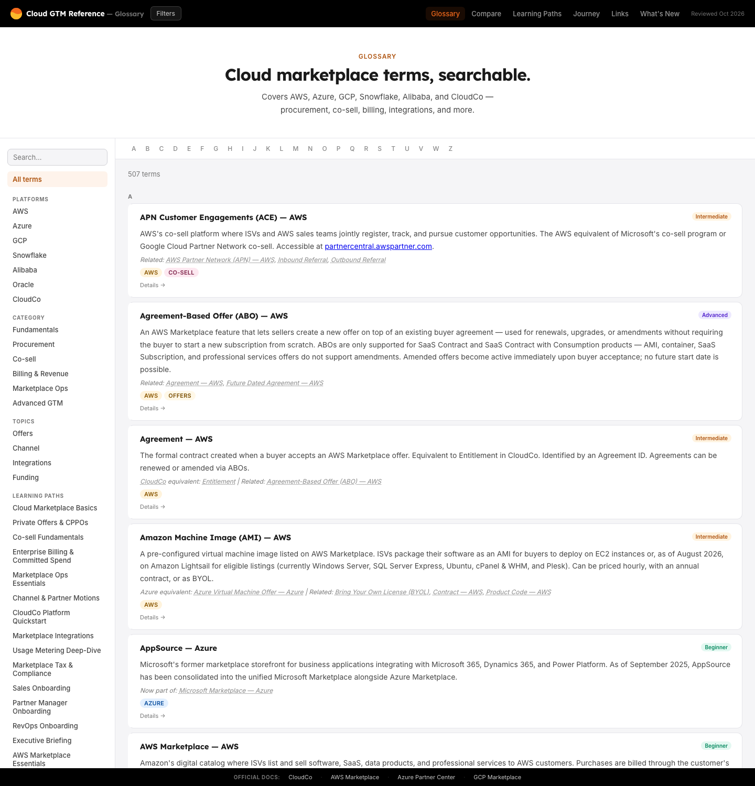

# The AGB Gazette

A three-page site built as plain HTML, CSS, and JavaScript. No framework, no build step, no
runtime dependencies.

The layout borrows the grammar of a broadsheet: a ruled paper sheet, masthead with ears, a
page-level nav bar, a lead story with a sidebar, hairline card grids, and numbered editorial
sections. The palette and type families are unchanged; only the structure is newspaper-shaped.
The masthead is **The AGB Gazette**; the kicker reads **Gelo Baring · Portfolio** on the work
pages and **Gelo Baring · Off the Clock** on the picture desk.

- `index.html` is the portfolio: nine highlights, a five-role career timeline, skills,
  training, and contact.
- `case-studies.html` is the detail page: four 2026 knowledge-system cases, earlier help
  center, client site, and internal tool work, the Furlinks capstone, three Boot.dev
  coursework builds, plus engineering notes, evidence, and limits.
- `photography.html` is the picture desk: a masonry grid of 35 photographs taken around the
  Philippines between 2017 and 2026, plus an after-hours essay and interests. It is the fun
  page; none of it is client work.

Employers are anonymized throughout. Client sites are named and linked because they are public
work.

## Files

```
gelobaring-intro/
├── index.html              portfolio: highlights, career, skills, training, contact
├── case-studies.html       detail: four 2026 cases, earlier work, training, engineering, limits
├── photography.html        Off the Clock: 35 plates, masonry grid, after-hours notes
├── css/
│   ├── tokens.css          design system: palette, type scale, spacing, z-index
│   ├── styles.css          newspaper structure: masthead, nav, lead, ruled grids, plates
│   └── print.css           paper output (loaded with media="print")
├── data/
│   ├── contents.js         one contents list per page, keyed by <body data-page>
│   ├── index.js            portfolio copy and records
│   ├── case-studies.js     case studies content, one block per section
│   └── photography.js      picture desk content, one block per section
├── js/
│   ├── contents.js         renders the contents drawer from data/contents.js
│   ├── render.js           builds <main> from the page's data module
│   ├── main.js             reading progress, drawer controls, pager, print, dateline
│   └── photography.js      keyboard-accessible lightbox for the picture desk
├── assets/
│   ├── 01–06.png           anonymized product screenshots (1440w fallback)
│   ├── 01–06.webp          same screenshots, smaller
│   ├── 01–06-720.*         responsive 720w variants used by srcset
│   ├── curriculum-map.svg  Case C curriculum map
│   ├── agent-gate.svg      Case D review-gate diagram
│   ├── og-card.png         1200×630 social card
│   ├── og-card.svg         social-card source
│   ├── og-photography.png  1200×630 picture-desk social card
│   ├── photography/        35 plates, each as JPEG + WebP at 1600w and 800w
│   ├── sites/              six client home-page screenshots, JPEG + WebP at 800w and 400w
│   ├── favicon-32.png      white GB monogram, ink background
│   ├── favicon-180.png     apple-touch icon
│   ├── favicon-512.png     high-resolution favicon
│   ├── favicon.svg         previous favicon, no longer referenced
│   ├── gelo-avatar-80.*    byline avatar, 1x (JPEG + WebP)
│   ├── gelo-avatar-160.*   byline avatar, 2x
│   ├── gelo-portrait-320.* contact portrait, 1x (4:5)
│   ├── gelo-portrait-640.* contact portrait, 2x
│   └── signature.png       personal mark
├── .gitignore              excludes local/private material from the repo
└── README.md               this file
```

The private briefing lives **outside** this folder, at `../SHOWCASE-BRIEFING.md`. The
interview-prep notes live at `../SHOWCASE-COMMENTS.md`. Do not move either back into
`gelobaring-intro/`; anything tracked in this folder is deployable.

## View it

```sh
cd gelobaring-intro
python3 -m http.server 8000
# http://localhost:8000
```

Opening `index.html` directly also works, but a server is closer to production and keeps
relative paths honest. Cross-document page transitions are more reliable over HTTP; some
browsers skip them on `file://`.

## Edit it

| What                                | Where                                                            |
| ----------------------------------- | ---------------------------------------------------------------- |
| Masthead, ears, date strip          | all three HTML files — `.masthead`                               |
| Page navigation                     | all three HTML files — `.paper-nav` (three page links only)      |
| Contents list (per page)            | `data/contents.js` — keyed by `<body data-page>`                 |
| Contents drawer                     | `js/contents.js` renders it; `js/main.js` handles open/close     |
| Page body and section shells        | `js/render.js` — builds `<main>` from the page data module       |
| Lead story, sidebar, byline         | `data/index.js`, `data/case-studies.js`, `data/photography.js`   |
| Highlight cards                     | `data/index.js` — `sections[0].items`                            |
| Career history                      | `data/index.js` — the `career` section                           |
| Skills, tools, background           | `data/index.js` — the `skills` section                           |
| Contact details                     | all three HTML files — `.contact` block                          |
| Author portrait and byline          | `index.html` — `.author-card`; `js/render.js` — `.byline-avatar` |
| Case-study copy                     | `data/case-studies.js` — the `#work` part                        |
| Earlier projects, client sites      | `data/case-studies.js` — the `#earlier` part                     |
| Client site screenshots             | `assets/sites/` — six home-page captures                         |
| Engineering notes, code samples     | `data/case-studies.js` — the `#engineering` part                 |
| Evidence table and timeline         | `data/case-studies.js` — the `#evidence` part                    |
| Limits                              | `data/case-studies.js` — the `#limits` part                      |
| Photo plates and captions           | `data/photography.js` — the `#gallery` part                      |
| Photo files                         | `assets/photography/` — generated from `old/assets/images/`      |
| Lightbox                            | `js/photography.js`                                              |
| Favicon                             | `assets/favicon-32.png`, `favicon-180.png`, `favicon-512.png`    |
| Colors, fonts, spacing              | `css/tokens.css` only                                            |
| Dark theme                          | `css/tokens.css` — the `[data-theme="dark"]` block               |
| Component styling                   | `css/styles.css`                                                 |
| PDF behavior                        | `css/print.css`                                                  |
| Theme bootstrap                     | all three HTML files — inline `<script>` in `<head>`             |
| Print button, contents state, pager | `js/main.js`                                                     |
| Dateline and last updated           | `js/main.js` — `[data-dateline]`, `[data-updated]`               |

### Page structure

`index.html`

| #   | Section    | ID            | Role                                           |
| --- | ---------- | ------------- | ---------------------------------------------- |
| 01  | Highlights | `#highlights` | Nine project cards, four linking to full cases |
| 02  | Career     | `#career`     | Five roles, 2015–2026, employers anonymized    |
| 03  | Skills     | `#skills`     | Six capabilities and tools                     |
| 04  | Training   | `#training`   | Courses, awards, and education                 |
| —   | Contact    | `#contact`    | Email, LinkedIn, GitHub                        |

`case-studies.html`

| #   | Section      | ID             | Role                                                               |
| --- | ------------ | -------------- | ------------------------------------------------------------------ |
| 01  | Context      | `#problem`     | The documentation problem and its cost                             |
| 02  | How it fits  | `#system`      | The three-layer model and pipeline                                 |
| 03  | Case studies | `#work`        | Four deep cases with jump links                                    |
| 04  | Earlier work | `#earlier`     | Help center, internal tool, six client sites, capstone, coursework |
| 05  | Training     | `#training`    | Courses, awards, and education                                     |
| 06  | Engineering  | `#engineering` | Architecture, code samples, delivery choices                       |
| 07  | Evidence     | `#evidence`    | Output counts, sources, 2026 timeline                              |
| 08  | Limits       | `#limits`      | What is not proven                                                 |
| —   | Contact      | `#contact`     | Email, LinkedIn, GitHub                                            |

`photography.html`

| #   | Section     | ID         | Role                                           |
| --- | ----------- | ---------- | ---------------------------------------------- |
| 01  | Gallery     | `#gallery` | 35 plates: one featured photograph and masonry |
| 02  | After hours | `#notes`   | Essay, interests, pull quote, and print note   |
| —   | Contact     | `#contact` | Email, LinkedIn, GitHub                        |

Section numbers, the contents labels in `data/contents.js`, the edition index in the lead
sidebar, and the CSS section comments must stay in sync. Section copy and records live in
`data/index.js`, `data/case-studies.js`, and `data/photography.js`; `js/render.js` builds the
body before `main.js` runs. `js/contents.js` renders the drawer list from its data before
`main.js` wires up scroll-spy and the pager. The `.section-next` pager is generated from the
same rendered list at runtime, so it follows the same order automatically. Deep links are
re-aligned after the pager is injected and again once the webfonts settle. The three pages
cross-link from the top navigation: the portfolio points to `case-studies.html` and
`photography.html`; the detail page points back to `index.html` and `photography.html`; the
picture desk points to both.

### Navigation and contents

The top navigation is page-level only and never changes shape: **Portfolio**, **Case
Studies**, and **Off the Clock**, with `aria-current="page"` on the active page. Section
links live in a floating contents drawer instead of the header.

- The drawer is a native `<dialog>` on every page. A fixed vertical **Contents** tab on the
  right edge opens it on desktop; below 900px it becomes a bottom-right pill.
- The list is data-driven: `data/contents.js` holds one list per page, keyed by
  `<body data-page>`, and `js/contents.js` renders it before `main.js` wires up scroll-spy
  and the pager. The drawer shell stays in HTML, so its heading, close button, and
  accessibility labels are not rebuilt at runtime.
- The trigger starts with the `hidden` attribute. `main.js` reveals it only after the rendered
  contents list exists, so a failed data load never exposes a dead control. The page body is
  rendered from `data/*.js`, so JavaScript is required; `<noscript>` explains that and gives
  the contact email.
- Open and close work through the trigger, the close button, a backdrop click, and Escape.
  Focus moves into the drawer and returns to the trigger when it closes. The page behind it
  does not scroll while the drawer is open.
- The panel slides in from the right over 340ms with a fade on the backdrop. The trigger is
  hidden while the drawer is open so it cannot shift or peek through the backdrop.
  `prefers-reduced-motion` removes the animation.
- The drawer doubles as the scroll-spy source: the current section gets
  `aria-current="true"` and a teal inset rule, and the same list feeds the previous / next
  pagers at the end of each section.

### Anonymization policy

All employers are described by what they do, never by name:

| Period              | Label                                            |
| ------------------- | ------------------------------------------------ |
| Jan – Oct 2026      | B2B SaaS company selling into cloud marketplaces |
| Sep 2023 – Dec 2025 | HR SaaS company serving restaurant teams         |
| Mar – Aug 2023      | Web development agency serving Japanese clients  |
| Dec 2017 – Jan 2023 | On-demand delivery platform                      |
| Jan 2015 – Jan 2016 | E-commerce marketplace                           |

The six 2023 client sites are named and linked because they are public portfolio pieces:
HYEG, Life Support Center Tomonokai, Maeda Chiropractic, Mori No Shion, Aladdin, and
Hanamizuki Chiropractic. The internal invoice system is described, not linked.

Screenshots use `Cloud GTM Reference` and `CloudCo Docs` instead of the real brand. Do not
reintroduce employer names, product names, internal links, or customer details.

### American English

The copy uses American spelling and usage: anonymized, organized, optimized, analyzed,
labeled, behavior, color, center, specialized, modeled, toward, normalizes. Keep it that way
when editing.

## Themes

Light is the default: khaki `#f4ecdc`. Dark uses a green-tinted charcoal page
`#131c18`, raised surfaces `#1c2a24`, and panels `#22332c` — no pure black. The desk behind
the sheet is `#0a100e`.

- On first visit the theme follows the visitor's OS (`prefers-color-scheme`).
- The theme button in the masthead and in the footer toggles it. Both stay in sync, the visible
  label switches between **Dark mode** and **Light mode**, and `aria-pressed` reflects state.
- The choice is stored in `localStorage` under `showcase-theme` and survives reloads.
- The bootstrap is inline in `<head>` so the attribute is set before first paint — no white
  flash. With JavaScript disabled the page shows the `<noscript>` notice instead of content.
- Print always renders light, whichever theme is active on screen.

Only the semantic roles change between themes: `--bg`, `--ink`, `--ink-2`, `--muted`,
`--muted-2`, `--teal-800`, `--rule`, `--stat-ink`, `--surface-raised`. `--forest` becomes a
lighter green panel in dark mode so panels, the code block, and button hovers read as raised
stock rather than black holes.

## Design tokens

| Token        | Value     | Role                                                 |
| ------------ | --------- | ---------------------------------------------------- |
| `--teal`     | `#00a385` | Accent fills, rules, markers — **not text on light** |
| `--teal-800` | `#00614f` | Derived: text-safe accent (6.33:1 on khaki)          |
| `--forest`   | `#00493a` | Dark panels, headings, strong numbers                |
| `--lint`     | `#d7d7a8` | Highlight wash                                       |
| `--khaki`    | `#f4ecdc` | Page background (light)                              |
| `--black`    | `#001f17` | Body text (light theme); dark ink is overridden      |

Typography: **Outfit** for display and UI labels, **Google Sans Flex** for body copy. The
Google Fonts request loads Outfit 400/500/600/700/800 and Google Sans Flex 400/500/600/700 —
the weights the CSS actually uses for the masthead, headlines, and labels.

### Newspaper components

- `.sheet` — the ruled broadsheet that wraps the masthead, nav, main, and footer. It sets the
  outer border, the paper background, and the faint horizontal texture. The body behind it is
  the desk tone; a small responsive body padding and a soft shadow make the sheet read as
  paper on a desk. Both are removed in print.
- `.masthead` — utility strip (date, edition, theme toggle), then a three-column grid: left
  ear, centered kicker/title/tagline, right ear. The title is **The AGB Gazette**; the kicker
  is **Gelo Baring · Portfolio** on the work pages and **Gelo Baring · Off the Clock** on the
  picture desk. The title is a `<p>`, not the page `h1`; each page keeps one `h1` in the lead.
- `.paper-nav` — the page-level navigation bar. It is a wrapping flex row of bordered cells
  linking the three pages; links invert to ink when active or hovered. It is not a section
  index.
- `.toc` / `.toc-toggle` — the floating contents drawer and its fixed trigger. The drawer is
  a native `<dialog>` with a right-side panel, numbered section links, a close button, and a
  backdrop. The trigger is a vertical tab on desktop and a pill on small screens. Hidden in
  print.
- `.section-next` — previous / next links injected at the end of each section by `main.js`.
  They mirror the contents-drawer order and give the reader a way to keep moving without
  scrolling back to the top. Hidden in print.
- `.colophon__top` — the **Back to top** link in the footer. Hidden in print.
- Page transitions — `@view-transition { navigation: auto; }` in `styles.css` enables
  cross-document view transitions. The root snapshots use a 5deg paper fold (2.5deg below
  600px) for 300ms with a light opacity fade. Chrome/Edge 126+ and Safari 18.2+ animate it;
  Firefox ignores the rule and navigates instantly. Same-page anchors and external links do
  not animate, and `prefers-reduced-motion` turns the fold off.
- Dateline — `js/main.js` fills `[data-dateline]` with today's date in `Asia/Manila` and
  `[data-updated]` with `document.lastModified`. The static text in the HTML is the no-JS
  fallback; changing a page updates its footer stamp automatically.
- `.lead` — the lead story grid: headline, deck, byline, and calls to action on the left; a
  signature, stat box, and notice on the right. The detail page swaps the stat box for an
  edition index.
- `.highlights` / `.hl-card` — the nine-card portfolio grid. Two columns at 760px, three at
  1060px. Each card is a flex column so the link sits at the bottom, and the link's `::after`
  covers the card for a full-card target. Cards carry `P. 01`–`P. 09` page labels.
- `.skills` / `.skill` — a hairline grid of six capabilities. Same breakpoints as the
  highlights grid, with automatic `01`–`06` numbering.
- `.training` / `.training__item` — the training and education grid: three columns on
  desktop, two at 760px, one on phones. Each item carries a provider/date label.
- `.interests` / `.interest` — the four-card after-hours grid on the picture desk: four
  columns on desktop, two at 700px, one on phones.
- `.case` / `.case-grid` — each case study is a feature with a ruled head, a body column, and
  a sidebar for facts and links.
- `.masonry` / `.plate` — the picture-desk grid. CSS multi-columns: one column on phones, two
  from 700px, three from 1060px. Each `.plate` is a bordered figure with a plate number,
  title, date, and a one-line note; `break-inside: avoid` keeps the caption with the image.
  `.plate--lead` is the full-width featured photograph above the grid.
- `.lightbox` — the native `<dialog>` viewer opened by `js/photography.js`. Arrow keys move
  between plates; Escape and the close button dismiss it and return focus to the plate that
  opened it. Each plate links to the full-size JPEG; the script intercepts the click.
- `.field-notes` / `.pullquote` — the after-hours essay and the ruled pull quote on the picture desk.
- `.panel-dark` — the forest supplement that carries the pipeline, layers, and principles.
- `.pills` — a list reset, so pill lists can use `<ul>` / `<li>` without browser markers or
  indentation. The case studies content still uses `<span class="pill">` inside `.pills`.

### Contrast (measured, not assumed)

Light theme:

| Pair                            | Ratio      | Verdict                   |
| ------------------------------- | ---------- | ------------------------- |
| Ink `#001f17` on khaki          | 14.80:1    | AAA                       |
| Forest `#00493a` on khaki       | 8.88:1     | AAA                       |
| `--teal-800` `#00614f` on khaki | 6.33:1     | AA                        |
| Muted `#4a5f56` on khaki        | 5.84:1     | AA                        |
| **Teal `#00a385` on khaki**     | **2.72:1** | **Fails — graphics only** |

Dark theme, measured against the page `#131c18`:

| Pair                           | Ratio   | Verdict |
| ------------------------------ | ------- | ------- |
| Khaki `#f4ecdc` on page        | 14.81:1 | AAA     |
| Ink-2 `#dbe7dd` on page        | 13.66:1 | AAA     |
| `--teal-800` `#9fe3d4` on page | 11.94:1 | AAA     |
| Muted `#b9c7bd` on page        | 9.91:1  | AAA     |
| Muted-2 `#a6b7ad` on page      | 8.28:1  | AAA     |

On raised `#1c2a24` surfaces the same text still clears AAA: khaki 12.72, muted 8.51,
muted-2 7.11, accent 10.25. On panels `#22332c`: khaki 11.33, muted 7.58, accent 9.13.

If you add a color, measure it in both themes before it becomes text.

## Content accuracy

The site's argument is that claims are verified. Keep it that way. Headline figures and where
to re-check them:

| Claim                                    | Where                                                                                                                                                    |
| ---------------------------------------- | -------------------------------------------------------------------------------------------------------------------------------------------------------- |
| 507 terms, 1,477 curated cross-links     | `marketplaceglossary-prototype-gelobaring/data/terms.js`                                                                                                 |
| 21 paths / 269 steps                     | `.../data/learning-paths.js`                                                                                                                             |
| 37 walkthroughs / 194 steps / 486 checks | `.../data/walkthroughs.js`                                                                                                                               |
| 36 comparison rows                       | `.../app/compare-data.js` (derived from aliases)                                                                                                         |
| 1,761 feed entries, 13 monitored sources | `.../data/whats-new.js`, `.../scripts/fetch-whats-new.js`                                                                                                |
| 319 commits                              | `git -C marketplaceglossary-prototype-gelobaring rev-list --count HEAD`                                                                                  |
| ~11k lines hand-written app code         | reference repo, excluding `data/`, `temp/`, and `scripts/`                                                                                               |
| 5 editions, 43 topics, 15 published      | briefing-platform repo, `data/`                                                                                                                          |
| 13 modules, 13 quizzes, 146 questions    | `lms-courses/training-modules/`, `lms-courses/quiz-content/`                                                                                             |
| 246-row source map, weeks 1–6            | `lms-courses/claude-contexts/source-map.md`                                                                                                              |
| 108 commits                              | `git -C lms-courses rev-list --count HEAD`                                                                                                               |
| 7 agent specs / 554 lines                | `cloud-marketplace-news-universal-guide/claude-contexts/agents/`                                                                                         |
| 777-line writing guide                   | `cloud-marketplace-news-universal-guide/claude-contexts/writing-guide.md`                                                                                |
| ~170-entry decision log                  | `cloud-marketplace-news-universal-guide/claude-contexts/features.md`, `marketplaceglossary-prototype-gelobaring/TODOFORLATER.md`, and project changelogs |
| 178-source inventory                     | `marketplaceglossary-prototype-gelobaring/info-sources.md` (unique URLs)                                                                                 |
| 295-line project manual                  | `marketplaceglossary-prototype-gelobaring/CLAUDE.md`                                                                                                     |
| 23 lessons, 40 corrections + 3 gaps      | `aws-ccp-coursework/aws-clf-c02-flagged-content-and-changes.md`                                                                                          |
| Furlinks: Laravel 9, six contributors    | `WD20P-Capstone-Furlinks/composer.json`; `git -C WD20P-Capstone-Furlinks shortlog -sne`                                                                  |
| Three Boot.dev builds                    | `bootdev-projs/ai-bot/`, `bootdev-projs/asteroids-py/`, `bootdev-projs/bookbot/`                                                                         |

Career claims come from the LinkedIn profile text, not from repository evidence. Re-check them
against the profile before publishing:

| Claim                                   | Source                                                               |
| --------------------------------------- | -------------------------------------------------------------------- |
| Five roles, Jan 2015 – Oct 2026         | LinkedIn profile, Experience                                         |
| HR SaaS role, Sep 2023 – Dec 2025       | LinkedIn profile; two titles in one tenure                           |
| Agency role, Mar – Aug 2023             | LinkedIn profile                                                     |
| Delivery platform, Dec 2017 – Jan 2023  | LinkedIn profile                                                     |
| Marketplace role, Jan 2015 – Jan 2016   | LinkedIn profile                                                     |
| Six client sites, Mar – Jul 2023        | Live URLs linked in `#earlier`; dates from the profile/project notes |
| Internal invoice system, Apr – May 2023 | Internal tool; not linked publicly                                   |

Deliberate wording choices:

- **8 pages**, not 10 — the two `temp/` samples are not production pages.
- **~11k lines** of hand-written application code, excluding data modules and tooling
  (`app/`, page scripts, CSS, and HTML). Including the ingestion script and the `temp/`
  samples pushes the count to ~13.7k; the site uses the narrower, deployable figure.
- **Curated cross-links**, not "typed" — the `related` entries are hand-authored.
- **Term difficulty is assigned per term against a rubric**, not derived from data.
- **Comparison rows are derived from the alias graph**, not parsed from prose.
- **13 monitored sources** feed the archive; a separate **16-source monitoring set** drives the
  AI agents. They are different systems and are labeled separately.
- **Curriculum scope**: weeks 1–4 are drafted; weeks 5–6 and the capstone are mapped only.
- **Answer key**: only Week 1–2 keys are hashed, and the file itself says the hashing is
  obfuscation, not security.
- **Earlier roles carry no invented metrics.** The site states scope and responsibilities, not
  percentages or impact figures, because none were measured or recorded.
- **Furlinks is a six-person capstone**, not solo work. The copy names the team and the
  KodeGo WD20P cohort; it does not claim sole authorship. The repository has six contributors.
- **The Boot.dev builds are guided coursework**, not client or product work. They are labeled
  as such; repository links are shared on request.
- **Repository links are not published.** The capstone and coursework cards name the work and
  stack but link to no repository. The footer says links are shared on request; keep those in
  sync if that policy changes.
- **Every employer is anonymized.** Client sites remain named and linked; the internal invoice
  system is described, not linked.
- **Output counts are not impact metrics.** Usage, completion, and repeat-question volume were
  not instrumented; the limits section says so.

## Publish it

GitHub Pages, no build required:

1. Deploy `gelobaring-intro/` as the site root (or a subpath).
2. Update the absolute URLs if the deployment path is not
   `https://gelogabz.github.io/gelobaring-intro/`:
   - `<link rel="canonical">` on all three pages
   - `og:url` on all three pages
   - `og:image` and `twitter:image` (the work pages use `og-card.png`; the picture desk uses
     `og-photography.png`)
   - `url` in the JSON-LD blocks on all three pages
3. Commit `index.html`, `case-studies.html`, `photography.html`, `css/`, `js/`, `assets/`,
   `.gitignore`, and this README.
4. **Do not** commit `SHOWCASE-BRIEFING.md`, `SHOWCASE-COMMENTS.md`, the `old/` folder, the
   parent workspace, `CLAUDE.md` files, or `claude-contexts/` directories. The `.gitignore`
   already excludes `old/`, `showcase-comments.md`, `.DS_Store`, and `*.pdf`.

The work pages use `assets/og-card.png` (1200×630). The picture desk uses
`assets/og-photography.png` (1200×630), built from the sea-of-clouds plate. If you change a
headline or masthead, regenerate the relevant card:

```sh
magick -background none assets/og-card.svg -resize 1200x630 assets/og-card.png
```

Without ImageMagick, screenshot the SVG at 1200×630 in a headless browser and save the result
over `assets/og-card.png`. The photography card is rendered from a small HTML overlay on the
photo; re-render it the same way if the copy changes.

### Privacy check before publishing

- Every employer is anonymized. The screenshots use `Cloud GTM Reference` / `CloudCo Docs`
  rather than the real brand. Product names and internal links stay out of all three pages.
- Client sites **are named**, with links to the live sites. That is intentional: they are
  public work and the links are the evidence. Do not add client contact details, contract
  values, or unpublished material.
- Client-site cards now include home-page screenshots. These are public pages, but several
  show recognizable people (Lifesuppo, Maeda, Hanamizuki, Aladdin). Confirm the client is
  comfortable with the capture before publishing or swapping one; do not add private pages,
  logged-in views, or customer data.
- Repository links for the capstone and Boot.dev builds are intentionally omitted. The footer
  says repository links are shared on request. Do not add them back without updating that
  sentence.
- Two of the source repositories are public and still contain real brand names, internal
  docs, and `claude-contexts/` material. Either sanitize them or do not link them from the
  site. The exact paths are in the private briefing.
- `showcase-comments.md` is interview-prep material and must not be tracked or deployed. It
  has been moved to `../SHOWCASE-COMMENTS.md`.
- The `old/` folder is the previous personal site and contains personal photos and the old
  employer logo. It is ignored by git and must not be deployed. The picture desk uses only
  the resized copies in `assets/photography/`.
- Some plates include recognizable people. Confirm you have permission to publish a face
  before adding or swapping a photo.
- Keep customer names, revenue figures, internal Slack links, and unredacted strategy docs out
  of all three pages and any public repo.

## Assets and screenshots

Screenshots are 1440px wide. Each has a WebP source, a PNG fallback, and 720w variants:

```html
<picture>
  <source
    srcset="assets/01-glossary-720.webp 720w, assets/01-glossary.webp 1440w"
    sizes="(min-width: 1180px) 1100px, 100vw"
    type="image/webp"
  />
  
</picture>
```

- Keep the declared `width` and `height` equal to the real file dimensions; a mismatch causes
  layout shift. `04-whats-new.png` is 1440×1400.
- The 720w files are generated with `sips --resampleWidth 720` (PNG) and
  `cwebp -resize 720 0` (WebP). Regenerate them if a screenshot changes.
- Images below the fold use `loading="lazy"`. `main.js` switches them to eager on
  `beforeprint` so the PDF is not full of blank frames.
- The two diagrams are SVG so they stay sharp in print and at any zoom.
- On mobile, wide tables and diagrams scroll inside labeled regions (`tabindex="0"`,
  `role="region"`); no page scrolls horizontally.

### Client site screenshots

The six 2023 client cards in `#earlier` each carry a home-page capture in `assets/sites/`.
Captures are taken at 1440×900 with a headless browser, then resized to 800×500 and 400×250:

- `slug-800.jpg/.webp` — 2x card image, 800×500
- `slug-400.jpg/.webp` — 1x fallback, 400×250

The JPEGs use quality 72 and the WebPs use `cwebp -q 80` (800w) or `-q 78` (400w). Images are
`loading="lazy"`, declared 800×500, and use the card grid's `sizes`. HYEG links to
`https://www.hyeg.jp/`; the old `/s/` path now returns a 404. Re-capture a site if its home
page changes, and keep the frame free of cookie banners, logged-in views, or personal data.

### Author portrait assets

The byline avatar and the contact portrait come from `old/assets/images/20210310_215950.jpg`.
The original is 6528×4896 with EXIF orientation 6 (rotate 90° clockwise). Browsers apply
that tag, but command-line tools do not, so crop from the browser-oriented 4896×6528 image
or bake the rotation first.

- `gelo-avatar-80.jpg/.webp` and `-160` — 1x/2x for the 32px circular byline avatar on all
  three pages. Decorative (`alt=""`) because “By Gelo Baring” is adjacent.
- `gelo-portrait-320.jpg/.webp` and `-640` — 1x/2x for the 160×200 contact portrait in the
  portfolio footer. The crop is 4:5 and keeps the full face and chest, not just the head.

Crops are taken with browser canvas from the oriented image, exported as JPEG, then converted
with `cwebp -q 82`. Keep the `` `width` and `height` equal to the display size (32×32,
160×200) so the box is reserved before the file loads. The contact portrait is lazy-loaded.
The original stays in `old/` and is gitignored. In print, the small byline avatar is hidden
because it turns into a dark dot; the larger contact portrait is kept.

### Photography assets

The picture desk is built from 35 files in `old/assets/images/`, resized into
`assets/photography/`. Each plate has four web files:

- `slug.jpg` and `slug.webp` — 1600px on the long edge, used by the lightbox and as the
  high-density `srcset` candidate.
- `slug-800.jpg` and `slug-800.webp` — 800px on the long edge, the default grid image.

The JPEGs are made with `sips --resampleHeightWidthMax 1600` (and `800`), then converted with
`cwebp -q 80` (and `-q 78`). Strip the EXIF block from new JPEGs after resizing so location
data does not ship; `cwebp` does not copy metadata by default. Keep the `width` and `height`
attributes in the HTML equal to the 1600px file's real dimensions. The originals stay in
`old/`; do not link to them from the site.

Plate 04 (`04-morning-ridge`) replaced the earlier **With company** frame. The source was
`IMG_0382.JPG` (iPhone SE, 2018-10-07 06:31:58, 4032×3024). The EXIF/GPS block was stripped
after resizing, then the file was exported at 1600×1200 and 800×600. The original and the old
plate files now live in `old/assets/images/` and are gitignored. To swap a plate, keep the
same four-file pattern and update the `<picture>` `srcset`, `width`, `height`, alt text, and
caption together.

## Accessibility checklist

- [x] Skip link, single `h1` per page, page-level `contentinfo` footer outside `<main>`
- [x] Heading order: `h1` → `h2` → `h3`/`h4`, no skipped levels
- [x] Every `figcaption` is inside its `<figure>`
- [x] Data tables use `<th scope="col">` and `<th scope="row">`
- [x] Wide tables and diagrams are keyboard-focusable and labeled
- [x] Page navigation is three links with `aria-current="page"` on the active page
- [x] Contents drawer is a native `<dialog>`: trigger, close button, Escape, and backdrop
      click all dismiss it; focus enters and returns; background scroll locks
- [x] Contents trigger is revealed by JavaScript, so it never appears as a dead control
- [x] Theme toggle is a real `button`, label and `aria-pressed` update with state
- [x] Keyboard-visible focus on all interactive elements
- [x] Picture-desk lightbox is a native `<dialog>` with arrow-key navigation, Escape, and a
      close button
- [x] Every plate has alt text and a visible caption; the masonry reflows to one column
- [x] Contrast measured for every text/background pair
- [x] `prefers-reduced-motion` respected
- [x] All images have alt text (decorative signature and byline avatar use `alt=""`)
- [x] Responsive from 320px to 1440px, no page-level horizontal scroll
- [x] `<noscript>` notice explains the JavaScript requirement and gives the contact email
- [ ] Verify tab order once in a real browser after editing
- [ ] Run one screen-reader pass (VoiceOver or NVDA) before publishing

## Print

`css/print.css` is loaded with `media="print"`:

- The sheet drops its desk frame and paper texture and prints white. The masthead keeps its
  rules and ears; the title prints at 40pt.
- Panels invert to white; links print black and external URLs expand in parentheses.
- Output is A4 with 16mm margins. The portfolio is 7 pages; the detail page is 23 pages; the
  picture desk is 11 pages.
- The lead collapses to one column, with the stat/index and notice boxes side by side beneath.
- Screenshots cap at 260px; tall screenshots at 340px; client-site captures cap at 150px and
  stay top-aligned; diagrams stop scrolling and shrink to the page width.
- `.case` is allowed to break across pages; individual figures, notes, flow steps, layers,
  roles, projects, client-site cards, highlight cards, and skills stay intact. Headings never
  split from their following content.
- The highlights, skills, outcomes, projects, client-site, flow, layer, path, and principle
  grids collapse to a single column for print. The picture-desk masonry prints in two columns,
  and each plate stays whole.
- The theme toggle, page nav, contents drawer and trigger, section pager, back-to-top link,
  progress bar, hero CTAs, and lightbox are hidden.
- The small byline avatar is hidden; the 160×200 contact portrait prints with its caption.
- Print from any page's **Print / save as PDF** button, or `Ctrl/Cmd + P`.

## Known gaps

- No automated visual regression or link check yet.
- Some accessibility work in the source projects is incomplete; the detail page says so in
  **Limits**.
- Impact is not measured. There is no usage analytics, completion data, or repeat-question
  count; the detail page states that in **Limits** rather than inventing a number.
- The canonical URLs are defaults. Update them if the site moves.
- The detail page is long by design. The contents drawer, the previous / next links at the end
  of each section, the edition index in the lead sidebar, and per-case deep links (`#case-a` …
  `#case-d`) are the way through it.
- Only the six client sites have live home-page screenshots. The capstone and Boot.dev builds
  have no hosted home page, so their cards stay text-only.
- The picture desk uses CSS multi-columns for the masonry effect, not a layout library. The
  reading order is column-first, so the plate numbers do not run left-to-right across a row.
- Photo dates come from EXIF where the file has it; a few frames are undated and labeled only
  **Philippines**. Locations are kept general on purpose. Add a place name only when it is
  verified.
- The photo originals stay in the gitignored `old/` folder. Only the resized copies in
  `assets/photography/` are deployable.

## Internal docs

- `../SHOWCASE-BRIEFING.md` — private prep notes, evidence index, interview talking points,
  and claims to avoid. **Not for publication.**
